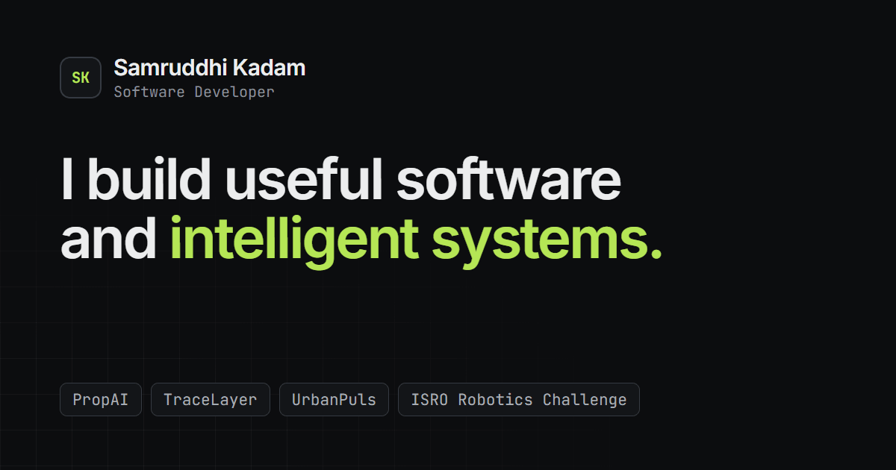
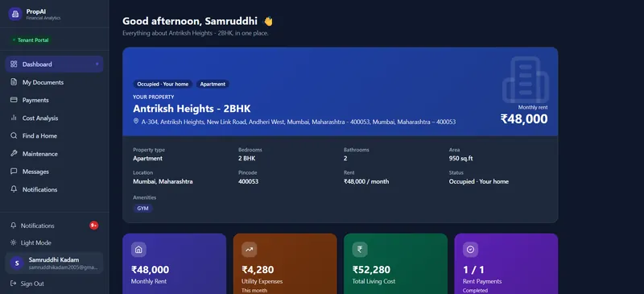
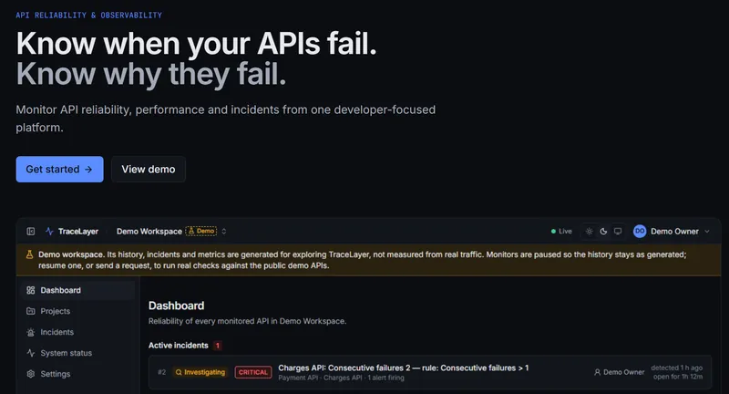
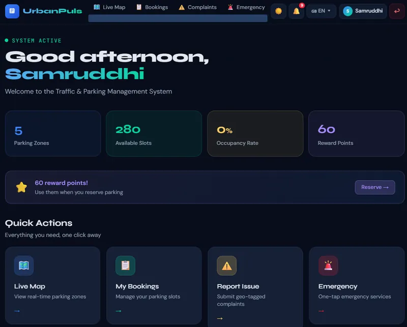
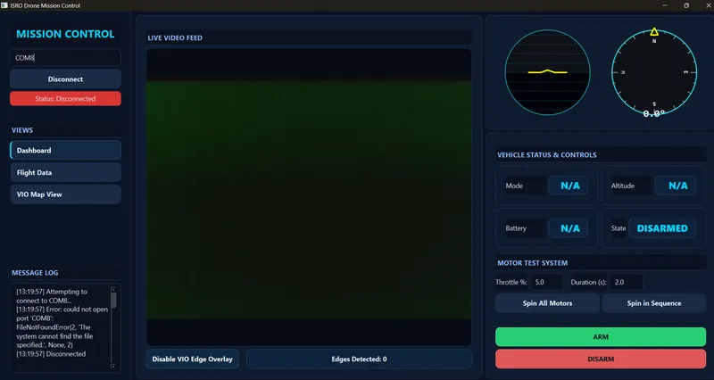

# Samruddhi Kadam | Developer Portfolio

A fast, accessible personal portfolio that presents the software I have built: full-stack
applications, developer tools and intelligent systems.

**Live site:** https://samruddhi-portfolio.vercel.app _(provisional, updated after the first deployment)_



## Overview

A frontend-only single-page application built with React, TypeScript and Vite. The home page has
five sections (Home, About, Skills, Projects and Contact), and three projects have their own
case-study pages. All content lives in typed data files, separate from the UI components, and is
taken from each project's real repository.

There is no backend, database or environment variable: the site builds to static files in
`dist/` and is hosted on Vercel.

## Features

- **Projects first.** Four projects in an alternating editorial layout, each clearly marked as an
  individual or group project, with real screenshots, the technology used and GitHub links.
- **Case studies** for PropAI, TraceLayer and UrbanPuls: overview, problem, solution with an
  architecture flow, key features, technology, technical challenges, engineering decisions
  (context → decision → reason → trade-off) and a screenshot gallery.
- **Interactive skills.** Selecting a technology highlights the projects that use it.
- **Screenshot viewer** with keyboard navigation (← → Esc), focus trapping and captions.
- **Dark and light themes**, designed separately. Dark by default; the first visit follows the
  system setting and the choice is remembered, with no flash of the wrong theme.
- **Responsive** from 320 px phones to wide desktops, with a full-screen mobile menu.
- **Accessible:** semantic landmarks, one `h1` per page, a skip link, visible focus states,
  WCAG AA contrast in both themes, screen-reader announcements and reduced-motion support.
- **SEO:** per-page titles, descriptions and canonical URLs, Open Graph and Twitter cards, a
  social preview image, JSON-LD, `robots.txt` and `sitemap.xml`.
- **Performance:** case studies are code-split and prefetched when the browser is idle, images are
  responsive WebP with reserved dimensions (no layout shift), and animations use a reduced
  Framer Motion bundle.
- **Resilient:** a 404 page, a "project not found" state, an error boundary and a fallback for
  images that fail to load.

## Tech stack

| Area      | Technology                                    |
| --------- | --------------------------------------------- |
| Framework | React 19, TypeScript (strict)                 |
| Build     | Vite                                          |
| Styling   | Tailwind CSS 4, CSS custom-property tokens    |
| Routing   | React Router                                  |
| Animation | Framer Motion (`LazyMotion` + `domAnimation`) |
| Icons     | Lucide React                                  |
| Fonts     | Inter, JetBrains Mono (self-hosted)           |
| Tooling   | pnpm, ESLint, Prettier, sharp (image script)  |
| Hosting   | Vercel                                        |

## Projects featured

| #   | Project                 | Type       | Category                                        | Repository                                                                                           |
| --- | ----------------------- | ---------- | ----------------------------------------------- | ---------------------------------------------------------------------------------------------------- |
| 01  | PropAI                  | Individual | AI / Data / Full Stack                          | [PropAI](https://github.com/SamruddhiKadam2023in/PropAI)                                             |
| 02  | TraceLayer              | Individual | Developer Tools / API Observability             | [TraceLayer](https://github.com/SamruddhiKadam2023in/TraceLayer)                                     |
| 03  | UrbanPuls               | Individual | Full Stack / Smart City                         | [UrbanPuls](https://github.com/SamruddhiKadam2023in/UrbanPuls)                                       |
| 04  | ISRO Robotics Challenge | Group      | Robotics / Computer Vision / Autonomous Systems | [ANAV_ISRO_Robotics_Challenge](https://github.com/SamruddhiKadam2023in/ANAV_ISRO_Robotics_Challenge) |

## Project structure

```text
├── public/
│   ├── images/<project>/      Optimized WebP screenshots (full size + -sm for small screens)
│   ├── favicon.svg, apple-touch-icon.png, og-image.png
│   ├── robots.txt
│   └── sitemap.xml
├── scripts/
│   └── optimize-images.mjs    Converts original screenshots into public/images
├── src/
│   ├── components/
│   │   ├── about/             About section and engineering-loop visual
│   │   ├── common/            Buttons, tags, theme, lightbox, images, toast, error states
│   │   ├── contact/           Contact section
│   │   ├── hero/              Hero, system diagram, technology strip
│   │   ├── navigation/        Navbar, mobile menu, footer, section links
│   │   ├── projects/          Project showcases and case-study components
│   │   └── skills/            Skills section and project highlighting
│   ├── data/                  All content: site, social, about, skills, projects, case studies
│   ├── hooks/                 Theme, page metadata, scroll, focus trap, clipboard, …
│   ├── layouts/MainLayout.tsx Skip link, navbar, page outlet, footer
│   ├── pages/                 Home, ProjectDetails, NotFound, RouteError
│   ├── types/                 Project, skill, theme and site types
│   ├── utils/                 Small helpers
│   ├── App.tsx                Router, error boundary, theme and motion providers
│   ├── main.tsx
│   └── index.css              Design tokens (both themes) and base styles
├── index.html                 Metadata, social tags, JSON-LD, theme script
└── vercel.json                SPA rewrites and caching headers
```

## Local setup

Requirements: **Node.js 22.12 or newer** and **pnpm**.

```bash
git clone https://github.com/SamruddhiKadam2023in/samruddhi-portfolio.git
cd samruddhi-portfolio
pnpm install
pnpm dev
```

The development server runs at http://localhost:5199.

## Commands

| Command             | What it does                                          |
| ------------------- | ----------------------------------------------------- |
| `pnpm dev`          | Start the development server                          |
| `pnpm build`        | Type-check and build the production site into `dist/` |
| `pnpm preview`      | Serve the production build at http://localhost:4199   |
| `pnpm typecheck`    | Run the TypeScript compiler                           |
| `pnpm lint`         | Run ESLint                                            |
| `pnpm format`       | Format all files with Prettier                        |
| `pnpm format:check` | Check formatting                                      |
| `pnpm images`       | Regenerate optimized screenshots (see below)          |

## Updating content

All text lives in `src/data/`, so content changes never touch components:

| File             | Contents                                                    |
| ---------------- | ----------------------------------------------------------- |
| `site.ts`        | Name, role, description, site URL, navigation               |
| `social.ts`      | Email, GitHub and LinkedIn                                  |
| `about.ts`       | About text, focus areas and the engineering loop            |
| `skills.ts`      | Skill categories and which projects use each skill          |
| `projects.ts`    | The four projects, screenshots, links and ISRO contribution |
| `caseStudies.ts` | Case-study content for the three individual projects        |

**Screenshots.** Put originals in a folder per project (`PropAI/`, `TraceLayer/`, `UrbanPlus/`,
`ANAV_ISRO/`) named `1_Name.png`, `2_Name.png`, and so on. The number sets the display order. Run
`pnpm images`, then add or update the entries in `src/data/projects.ts`. The original folders are
git-ignored; only the optimized copies are committed.

**Live demos.** A project shows a "Live demo" button only when `liveUrl` is set in
`src/data/projects.ts`.

## Screenshots

| PropAI                                                                       | TraceLayer                                                            |
| ---------------------------------------------------------------------------- | --------------------------------------------------------------------- |
|  |  |
| **UrbanPuls**                                                                | **ISRO Robotics Challenge**                                           |
|   |      |

## Deployment

The site is deployed on **Vercel** from this GitHub repository. Every push to `main` triggers a
new production deployment.

| Setting          | Value          |
| ---------------- | -------------- |
| Framework        | Vite           |
| Install command  | `pnpm install` |
| Build command    | `pnpm build`   |
| Output directory | `dist`         |

`vercel.json` rewrites every route to `index.html`, so links such as `/projects/propai` work on
direct visits and refreshes, and marks the hashed files in `/assets` as cacheable for a year.

No environment variables are required.

**After the site URL changes**, update it in `src/data/site.ts`, `index.html`, `public/robots.txt`
and `public/sitemap.xml`.

## Quality checks

Verified on the production build before deployment:

- Chrome, Edge and Firefox at 1440, 1280, 820 and 390 px: every route, refresh on deep links,
  theme persistence, navigation, skill highlighting, screenshot viewer and copy email, with no
  console errors.
- axe-core (WCAG 2.1 A/AA): no violations in either theme, including with the mobile menu,
  screenshot viewer and skill highlighting open.
- Keyboard-only navigation with visible focus on every interactive element.
- No layout shift (CLS 0) and no horizontal scrolling from 320 px upwards.

## Future improvements

- Pre-render each route to static HTML so link previews show page-specific titles.
- Add live demo links for projects as they are deployed.
- A per-project social preview image for each case study.

---

© 2026 Samruddhi Sanjay Kadam
